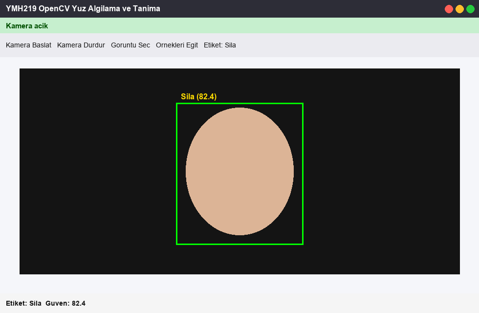
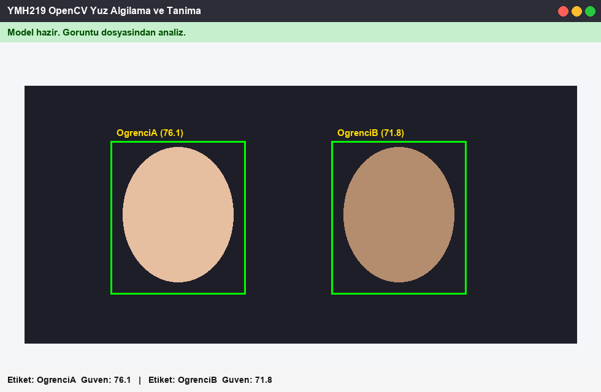

# YMH219-FaceRecognition

OpenCvSharp ile kameradan veya dosyadan görüntü alan, yüzleri dikdörtgenle işaretleyen ve küçük yerel örnek kümede LBPH ile etiketleyen Windows Forms uygulaması.

**Öğrenci:** Sıla Ağgül  
**Öğrenci No:** 250541020  
**Ders:** Nesne Tabanlı Programlama (YMH 219)

## Kullanılan teknolojiler / NuGet

- C# / .NET 8
- Windows Forms
- OpenCvSharp4 4.10.0.20241108
- OpenCvSharp4.Extensions 4.10.0.20241108
- OpenCvSharp4.Windows 4.10.0.20241108 (yerel OpenCV çalışma zamanı)
- Haar cascade: `haarcascade_frontalface_default.xml`

## Temel özellikler

- Kamera Başlat / Durdur
- Görüntü seç (jpg/png/bmp)
- Algılanan her yüz için dikdörtgen (aynı karede birden fazla yüz)
- Yerel örnekler: `Samples/OgrenciA` ve `Samples/OgrenciB` (en az iki etiket)
- Tahmin edilen etiket ve güven skoru
- Kamera veya cascade yoksa hata mesajı
- “Bu Yüzü Kaydet” ile yeni eğitim örneği
- İsteğe bağlı: algılanan yüzleri `CapturedFaces` klasörüne kaydetme

## Kurulum ve çalıştırma

1. Visual Studio 2022, .NET 8, bağlı bir webcam (isteğe bağlı; dosyadan da çalışır).
2. `YMH219-FaceRecognition.sln` dosyasını açın, NuGet geri yükleme tamamlansın.
3. F5 ile çalıştırın.
4. Daha iyi tanıma için kendi fotoğraflarınızı `Samples\<Etiket>\` altına koyun veya kamerada **Bu Yüzü Kaydet** + **Örnekleri Eğit** kullanın.

```powershell
dotnet restore
dotnet run --project FaceRecognition
```

Cascade dosyası derleme çıktısına kopyalanır. Silinirse uygulama bunu bildirir.

## Kapsam

Yalnızca ders içi, gönüllü/yerel örnekler içindir. Kamuya açık alanda izinsiz kimlik takibi veya gizli görüntü toplama amaçlı kullanılmamalıdır.

## Ekran görüntüleri

### Kamera



### Dosyadan iki yüz



## Bilinen sınırlamalar

- Depodaki `OgrenciA` / `OgrenciB` görüntüleri şematik örneklerdir; gerçek yüzlerle yeniden eğitim tanımayı iyileştirir.
- LBPH ışık ve açı değişimlerine duyarlıdır.
- Kamera indeksi 0 kullanılır; harici kamera için kodda indeks değiştirilebilir.
